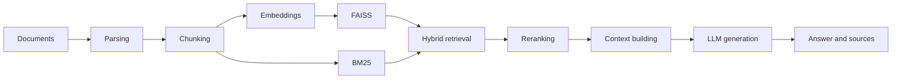

<div align="center">

# DocPilot

A local-first document RAG assistant with persistent knowledge, structured citations, and evaluation

English | [简体中文](README.zh-CN.md)

[](https://github.com/jackliu1376/docpilot/actions/workflows/ci.yml)
[](LICENSE)
[](https://www.python.org/)

</div>

DocPilot is a local-first RAG document assistant built for inspection and extension. Document loading, chunking, embeddings, FAISS, BM25, hybrid retrieval, reranking, citations, and answer generation are split into readable, replaceable modules. It ships with a Gradio UI, a FastAPI interface, SQLite persistence, and a retrieval/answer evaluation harness.

> It is an educational and portfolio-oriented implementation, not a production-ready knowledge-base service. Add authentication, tenant isolation, security controls, and deployment governance before using real business data.


## Project status

This repository extends the original educational RAG demo with:

- SQLite-backed persistence and incremental indexing
- Chinese BGE embeddings and a real CrossEncoder reranker
- Structured `[S1]` citations returned by the API and shown in the UI
- Retrieval and answer-level evaluation harnesses
- 56 credential-free tests

Retrieval baseline (8 files, 140 chunks, 46 questions): Chinese BGE + BGE reranker reaches
**Recall@5 0.8982**, **MRR@5 0.8822**, and **nDCG@5 0.8446**. The 10-question answer evaluation
compares local `qwen2.5:3b` with DeepSeek v4.1 Flash and GLM 5.3 Flash. DeepSeek leads citation
recall (0.95) and is judged correct/faithful on all 10 questions; GLM also reaches 10/10, though
60% of its judge calls used GLM itself as a fallback. The local 3B is correct on 5/10 and faithful
on 7/10 despite winning lexical F1. See [`eval/README.md`](eval/README.md) for the full table.

## Why this project

- **Persistent knowledge base**: SQLite + incremental dedup/replace; restart without re-uploading.
- **Inspectable pipeline**: core modules follow the order in which a RAG request is processed.
- **Hybrid retrieval**: combines FAISS dense retrieval with BM25 keyword retrieval.
- **Structured citations**: `[S1]` labels with filename/chunk and web-source metadata.
- **Measurable quality**: retrieval and answer-level evaluation harnesses.
- **Multiple model backends**: local Ollama, DeepSeek, Zhipu GLM, and other OpenAI-compatible APIs.
- **Document support**: PDF, TXT, Markdown, DOCX, XLS/XLSX, and PPTX.
- **Two interfaces**: a Gradio web application and a FastAPI REST API.

## RAG pipeline



## Quick start

### 1. Create an environment

```bash
git clone https://github.com/jackliu1376/docpilot.git
cd docpilot

python3.10 -m venv .venv
source .venv/bin/activate  # Windows: .venv\Scripts\activate
python -m pip install --upgrade pip
pip install -r requirements.txt
```

### 2. Configure one model backend

```bash
cp example.env .env
```

Edit `.env` and choose at least one option:

- set `SILICONFLOW_API_KEY`;
- set `MAGICK_API_KEY`, its endpoint, and model name; or
- start Ollama locally and pull the model configured in `.env`.

Keep real credentials in your local `.env` file. Values beginning with `Your_` are treated as placeholders and are not valid credentials.

### 3. Start the web UI

```bash
python rag_demo.py
```

The application first tries `http://127.0.0.1:17995`, then ports 17996–17999 if needed.

### 4. Start the REST API

```bash
python api_router.py
```

Main endpoints:

- `GET /api/status`: runtime, document-count, and provider configuration status;
- `POST /api/upload`: upload and persist a document;
- `POST /api/ask`: ask a question; returns the answer and structured sources;
- `GET /api/documents`: list persisted documents;
- `DELETE /api/documents/{filename}`: remove a document;
- `POST /api/clear`: clear the knowledge base.

## Repository layout

```text
├── config.py                  # Environment, model, and RAG settings
├── rag_demo.py                # Gradio web UI
├── api_router.py              # FastAPI interface
├── core/
│   ├── document_loader.py     # Document extraction
│   ├── text_splitter.py       # Text chunking
│   ├── embeddings.py          # Embeddings
│   ├── vector_store.py        # FAISS index
│   ├── bm25_index.py          # BM25 index
│   ├── knowledge_base.py     # SQLite persistence and incremental indexing
│   ├── answer.py              # Structured sources and citation parsing
│   ├── retriever.py           # Hybrid and recursive retrieval
│   ├── reranker.py            # Result reranking
│   └── generator.py           # Context and answer generation
├── features/                  # Web search and optional extensions
├── tests/                     # Tests that require no external credentials
└── .github/                   # CI, issue forms, and pull request template
```

## Tests

```bash
pip install -r requirements-dev.txt
PYTEST_DISABLE_PLUGIN_AUTOLOAD=1 python -m pytest
```

The current suite covers:

- configuration and default backend selection;
- document loading and unsupported-file behavior;
- BM25/hybrid retrieval and answer/citation metrics;
- SQLite persistence, dedup/replace, and API document endpoints;
- structured answer sources and missing-key fallback.

GitHub Actions compiles the Python sources and runs the test suite for every pull request.

## Configuration

See [`example.env`](example.env) for the complete example. Common variables include:

| Variable | Purpose |
| --- | --- |
| `DEEPSEEK_API_KEY` | DeepSeek API credential |
| `DEEPSEEK_API_URL` | DeepSeek base URL (default `https://api.deepseek.com/v1`) |
| `DEEPSEEK_MODEL_NAME` | DeepSeek model ID (default `deepseek-v4.1-flash`) |
| `GLM_API_KEY` | Zhipu GLM API credential |
| `GLM_API_URL` | GLM base URL (default `https://open.bigmodel.cn/api/paas/v4`) |
| `GLM_MODEL_NAME` | GLM model ID (default `glm-5.3-flash`) |
| `OLLAMA_MODEL_NAME` | Local Ollama model name |
| `OLLAMA_MAX_OUTPUT_TOKENS` | Max tokens per Ollama answer (default 1024) |
| `OLLAMA_QUERY_MAX_TOKENS` | Max tokens for Ollama query rewriting (default 64) |
| `OLLAMA_TIMEOUT_SECONDS` | Ollama request timeout in seconds (default 300) |
| `EMBED_MODEL_NAME` | Embedding model ID (default `all-MiniLM-L6-v2`) |
| `EMBED_QUERY_PREFIX` | Optional query instruction prefix for BGE models |
| `SEARCH_PROVIDER` | `tavily` (default) or `serpapi` |
| `TAVILY_API_KEY` | Optional Tavily web-search credential |
| `SERPAPI_KEY` | Optional legacy SerpAPI credential |
| `RERANK_METHOD` | `cross_encoder` or `llm` |
| `RERANK_MODEL_NAME` | CrossEncoder model ID (default `BAAI/bge-reranker-base`) |
| `RAG_DATA_DIR` | Persistent data directory (default `data/`) |

## Persistence

The knowledge base is stored in SQLite at `data/rag.db` (override with
`RAG_DATA_DIR`). FAISS and BM25 are derived indexes rebuilt at startup and
after each write.

Uploads are deduplicated by SHA-256: unchanged files are skipped, and a
changed file with the same name replaces its old document. `data/` is
gitignored; delete it or call `POST /api/clear` to reset the knowledge base.

Run the UI and API with the same `EMBED_MODEL_NAME`. A model mismatch triggers
automatic re-embedding, and the loader repairs mixed-dimension rows left by
cross-process writes.

The evaluation harness (`eval/run_retrieval_eval.py`) builds its own in-memory
index from `eval/data/`; it does not use the persisted knowledge base.

## Structured citations

`/api/ask` returns `answer`, `sources`, and `metadata`. Each source has an `id`
(`S1`, `S2`, ...), `kind` (`local` or `web`), `snippet`, and the relevant
filename/chunk or web URL metadata. The prompt asks the model to cite `[S1]`
inline, and the Gradio UI appends the source list under the answer.

The answer-level harness in `eval/run_answer_eval.py` measures token F1,
citation precision/recall, refusal rate, and optional LLM
correctness/faithfulness scores. It calls Ollama or a cloud backend, so start
with `--limit` and see `eval/README.md` for details.

## Known limitations

- PDF extraction reads the text layer and does not provide general-purpose OCR.
- Excel and PowerPoint extraction focuses on text rather than visual layout.
- The knowledge base is persisted in SQLite; FAISS and BM25 are rebuilt at startup. The UI and API are separate processes, so each may serve a stale in-memory index until it reloads.
- Embedding and reranking models may be downloaded on first use.
- Cloud model and web-search requests send the relevant query to third-party services; review your data boundary first.

## Contributing

Reproducible bug reports, documentation improvements, and focused pull requests are welcome. Read [`CONTRIBUTING.md`](CONTRIBUTING.md) and [`CODE_OF_CONDUCT.md`](CODE_OF_CONDUCT.md) before contributing.

Do not open a public issue for a vulnerability. Follow [`SECURITY.md`](SECURITY.md) instead.

## Releases and maintenance

- Changelog: [`CHANGELOG.md`](CHANGELOG.md)
- Releases: [GitHub Releases](https://github.com/jackliu1376/docpilot/releases)
- Maintainer: [jackliu1376](https://github.com/jackliu1376)

## Attribution

This project started from the MIT-licensed
[Local PDF Chat RAG](https://github.com/weiwill88/Local_Pdf_Chat_RAG) by Will Wei.
SQLite persistence, Chinese BGE retrieval, structured citations, and the evaluation
harness are additions in this repository.

## License

Released under the [MIT License](LICENSE).
