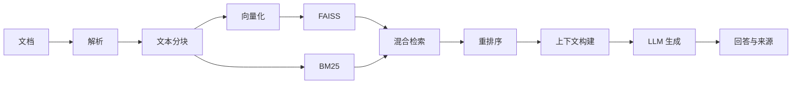

<div align="center">

# DocPilot

本地优先的文档 RAG 助手：持久化知识库、结构化引用与可量化评测

[English](README.md) | 简体中文

[](https://github.com/jackliu1376/docpilot/actions/workflows/ci.yml)
[](LICENSE)
[](https://www.python.org/)

</div>

DocPilot 是一个本地优先的 RAG 文档助手，面向希望理解并扩展检索增强生成链路的开发者。项目把文档解析、文本分块、向量化、FAISS、BM25、混合检索、重排序、结构化引用和回答生成拆成可以单独阅读、测试和替换的模块，并提供 Gradio 界面、FastAPI 接口、SQLite 持久化和检索/答案评测。

> 本仓库是教学与作品集用途的参考实现，不是开箱即用的生产级知识库服务。用于真实业务前，请补充身份鉴权、租户隔离、安全审计和部署治理。


## 项目状态

本仓库在原始教学 RAG Demo 基础上增加了：

- SQLite 持久化与增量索引
- 中文 BGE embedding 和真正的 CrossEncoder 重排
- 结构化 `[S1]` 引用，API 返回并在 UI 展示
- 检索与答案级评测
- 56 个无外部密钥的测试

检索基线（8 个文件、140 个 chunk、46 条问题）：中文 BGE + BGE 重排达到
**Recall@5 0.8982**、**MRR@5 0.8822**、**nDCG@5 0.8446**。答案级评测的 2 条问题冒烟结果为
Token F1 0.1486、引用准确率/召回率 0.5000，详细设置见 [`eval/README.md`](eval/README.md)。

## 项目特点

- **持久化知识库**：SQLite + 增量去重/替换，重启后无需重新上传。
- **链路透明**：核心步骤按 RAG 执行顺序拆分，便于学习和调试。
- **混合检索**：结合 FAISS 向量检索和 BM25 关键词检索。
- **结构化引用**：`[S1]` 标注，附带文件名/chunk 或网页来源元数据。
- **可量化质量**：检索和答案级评测脚本。
- **多模型后端**：支持本地 Ollama、SiliconFlow 以及 OpenAI-compatible API。
- **多种文档格式**：支持 PDF、TXT、Markdown、DOCX、XLS/XLSX 和 PPTX。
- **双入口**：提供 Gradio Web UI 和 FastAPI REST API。

## RAG 流程



## 快速开始

### 1. 创建环境

```bash
git clone https://github.com/jackliu1376/docpilot.git
cd docpilot

python3.10 -m venv .venv
source .venv/bin/activate  # Windows: .venv\Scripts\activate
python -m pip install --upgrade pip
pip install -r requirements.txt
```

### 2. 配置一个模型后端

```bash
cp example.env .env
```

编辑 `.env`，至少完成下面一种配置：

- 设置 `SILICONFLOW_API_KEY`；
- 设置 `MAGICK_API_KEY`、服务地址和模型名称；
- 本地启动 Ollama，并拉取 `.env` 中配置的模型。

密钥只保存在本地 `.env` 中。请勿提交真实密钥；示例配置中的 `Your_...` 占位符不会被识别为有效密钥。

### 3. 启动 Web UI

```bash
python rag_demo.py
```

应用默认尝试 `http://127.0.0.1:17995`，端口被占用时会依次尝试 17996–17999。

### 4. 启动 REST API

```bash
python api_router.py
```

主要接口：

- `GET /api/status`：运行状态、文档数量与后端配置状态；
- `POST /api/upload`：上传并持久化文档；
- `POST /api/ask`：基于持久化文档提问，返回答案和结构化来源；
- `GET /api/documents`：列出已持久化文档；
- `DELETE /api/documents/{filename}`：删除文档；
- `POST /api/clear`：清空知识库。

## 项目结构

```text
├── config.py                  # 环境变量、模型与 RAG 参数
├── rag_demo.py                # Gradio Web UI
├── api_router.py              # FastAPI 接口
├── core/
│   ├── document_loader.py     # 文档解析
│   ├── text_splitter.py       # 文本分块
│   ├── embeddings.py          # 向量化
│   ├── vector_store.py        # FAISS 索引
│   ├── bm25_index.py          # BM25 索引
│   ├── knowledge_base.py     # SQLite 持久化与增量索引
│   ├── answer.py              # 结构化来源与引用解析
│   ├── retriever.py           # 混合与递归检索
│   ├── reranker.py            # 结果重排序
│   └── generator.py           # 上下文和回答生成
├── features/                  # 联网搜索、冲突检测等扩展能力
├── tests/                     # 无外部密钥的自动化测试
└── .github/                   # CI、Issue 与 PR 模板
```

## 测试

```bash
pip install -r requirements-dev.txt
PYTEST_DISABLE_PLUGIN_AUTOLOAD=1 python -m pytest
```

当前测试覆盖：

- 配置和默认后端选择；
- 文档加载和不支持格式行为；
- BM25/混合检索与答案/引用指标；
- SQLite 持久化、去重/替换和 API 文档接口；
- 结构化答案来源与缺少 Key 时的回退。

所有 Pull Request 都会通过 GitHub Actions 执行源码编译和测试。

## 配置说明

完整示例见 [`example.env`](example.env)。常用变量包括：

| 变量 | 作用 |
| --- | --- |
| `SILICONFLOW_API_KEY` | SiliconFlow API 密钥 |
| `SILICONFLOW_MODEL_NAME` | SiliconFlow 模型 ID |
| `MAGICK_API_KEY` | OpenAI-compatible 服务密钥 |
| `MAGICK_API_URL` | 服务 base URL 或完整 Chat Completions URL |
| `MAGICK_MODEL_NAME` | 服务端模型 ID |
| `OLLAMA_MODEL_NAME` | 本地 Ollama 模型名称 |
| `OLLAMA_MAX_OUTPUT_TOKENS` | Ollama 单次回答最大 token 数（默认 1024） |
| `OLLAMA_QUERY_MAX_TOKENS` | Ollama 查询改写最大 token 数（默认 64） |
| `OLLAMA_TIMEOUT_SECONDS` | Ollama 请求超时秒数（默认 300） |
| `EMBED_MODEL_NAME` | 向量化模型 ID（默认 `all-MiniLM-L6-v2`） |
| `EMBED_QUERY_PREFIX` | BGE 模型可选的查询指令前缀 |
| `SERPAPI_KEY` | 可选联网搜索密钥 |
| `RERANK_METHOD` | `cross_encoder` 或 `llm` |
| `RERANK_MODEL_NAME` | CrossEncoder 模型 ID（默认 `BAAI/bge-reranker-base`） |
| `RAG_DATA_DIR` | 持久化数据目录（默认 `data/`） |

## 持久化

知识库保存在 SQLite（默认 `data/rag.db`，可用 `RAG_DATA_DIR` 覆盖）。FAISS 和 BM25
是在启动时和每次写入后重建的派生索引。

上传按 SHA-256 去重：未变化的文件跳过，内容变化的同名文件会替换旧文档。`data/`
已加入 `.gitignore`；删除该目录或调用 `POST /api/clear` 即可重置知识库。

UI 和 API 应使用相同的 `EMBED_MODEL_NAME`。模型不一致会触发自动重嵌入，
加载时也会修复跨进程写入造成的混合维度向量。

评测脚本（`eval/run_retrieval_eval.py`）从 `eval/data/` 构建自己的内存索引，
不使用持久化知识库。

## 结构化引用

`/api/ask` 返回 `answer`、`sources` 和 `metadata`。每个来源包含 `id`
（`S1`、`S2`...）、`kind`（`local`/`web`）、`snippet`，以及本地文件名/chunk
或网页 URL 等元数据。Prompt 要求模型在回答中用 `[S1]` 标注引用，Gradio UI 会在
回答下方列出结构化来源。

答案级评测脚本 `eval/run_answer_eval.py` 会统计 Token F1、引用准确率/召回率和
拒答率。它需要本地 Ollama，建议先用 `--limit` 跑少量问题，详细说明见
`eval/README.md`。

## 已知边界

- PDF 采用文本层提取，不包含通用 OCR；扫描件需要先做 OCR。
- Excel 与 PPT 的解析以文本提取为主，不保留完整视觉布局。
- 知识库持久化在 SQLite，FAISS 和 BM25 在启动时重建；UI 与 API 是独立进程，各自可能短暂使用旧的进程内索引。
- 首次使用向量或重排序模型时可能需要下载模型文件。
- 联网搜索和云端模型会把相应查询发送到第三方服务，请先确认数据边界。

## 参与贡献

欢迎提交可复现的 Bug、文档改进和聚焦的功能 Pull Request。开始前请阅读 [`CONTRIBUTING.md`](CONTRIBUTING.md) 和 [`CODE_OF_CONDUCT.md`](CODE_OF_CONDUCT.md)。

安全问题请不要创建公开 Issue，具体流程见 [`SECURITY.md`](SECURITY.md)。

## 版本与维护

- 变更记录：[`CHANGELOG.md`](CHANGELOG.md)
- 已发布版本：[GitHub Releases](https://github.com/jackliu1376/docpilot/releases)
- 当前维护者：[jackliu1376](https://github.com/jackliu1376)

## 来源说明

本项目基于 Will Wei 的 MIT 许可项目
[Local PDF Chat RAG](https://github.com/weiwill88/Local_Pdf_Chat_RAG)。
SQLite 持久化、中文 BGE 检索、结构化引用和评测脚本是本仓库新增的内容。

## 许可证

本项目采用 [MIT License](LICENSE)。
